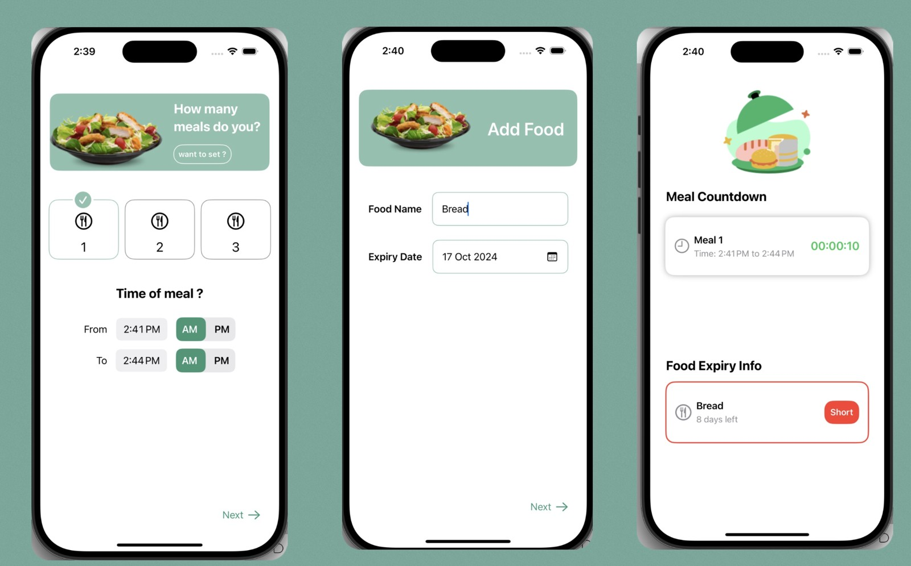

# Foodi 🍽️⏰

<!-- أضيفي لوقو التطبيق هنا:  -->

**Never let your food expire again**

---

## 📍 About Foodi 📍
Foodi is an iOS app that helps busy people stay on top of their meals and their food. It reminds you when it's time to eat and warns you before your food reaches its expiry date, so nothing goes to waste.

Built for the **Apple Developer Academy** challenge: *"Use reminders to improve people's lives."*

---

## 🌟 Key Features

- **Meal Planning** 🍴: Choose how many meals you have a day (1, 2 or 3) and set the time of each one
- **Add Your Food** 🥖: Save any food item with its name and expiry date
- **Meal Countdown** ⏱️: A live timer that shows how much time is left for your meal
- **Expiry Tracking** ⚠️: See how many days are left for each item, with a red **Short** badge when it's about to expire

---

## 💻 Tech Stack

- 🚀 **Swift**: Core application development
- 🛠️ **Xcode**: Development environment
- 📱 **iOS**: Target platform
- 🐙 **GitHub**: Collaborative development and version control

---

## 🚀 Advantages

### 🌱 Less Food Waste
- ♻️ Reminds you before food expires
- 🛒 Helps you use what you already have

### ⏰ Stay on Schedule
- 🍽️ Keeps your meal times on track
- ⚡ Simple setup, no complicated steps

### 🧘 Made for Busy People
- 📲 Quick to add and easy to read
- 🎯 Shows only what matters: your next meal and what's expiring

---

## 📱 Screens Overview

1. **Meals Setup (🍴)**
   - Choose how many meals you have a day and set the time window for each.

2. **Add Food (🥖)**
   - Enter the food name and its expiry date.

3. **Home (🏠)**
   - **Meal Countdown:** a live timer for your current meal.
   - **Food Expiry Info:** days left for every item, with a **Short** badge when it's close to expiring.

---

## 👩‍💻 Team Novanex

- [Alshaimaa Alamer](https://github.com/Alshaimaa00)
- Sadeem Orwoq
- Asma Almutairi
- Sara Ali Hakmi
- Noura Sultan Alqhamdi

---

<!-- ℹ️ More Information: أضيفي رابط التصميم أو العرض هنا
[🔗 View Full Design on Behance](YOUR_LINK)
-->

**Eat on time, waste less 💚**

